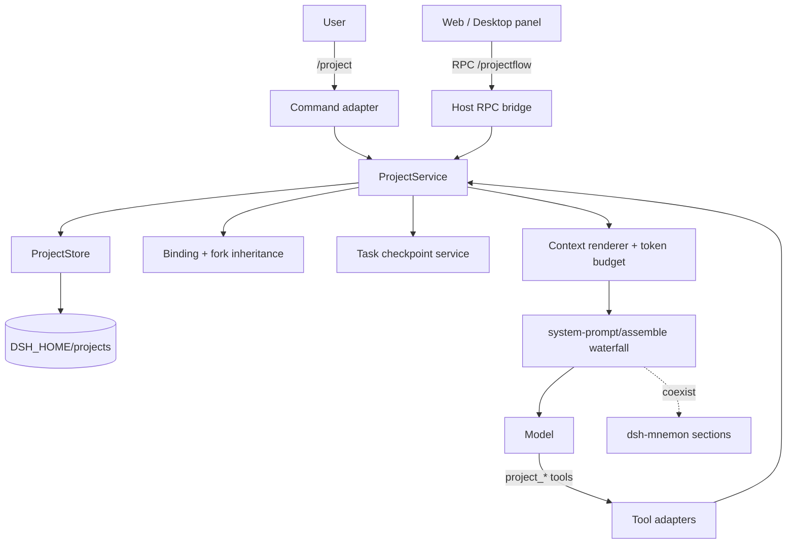

# dsh-projectflow

**Project-first workspaces for DeepSeek Harness.** A DSH plugin that makes the project — not the current folder — the durable unit of context, task state, references, and workspace composition.

`dsh-projectflow` gives every project a stable id and a data home under `$DSH_HOME/projects/<projectId>/`. Any session in any directory can join the same project and inherit its conventions, decisions, progress, references, and current task checkpoint. Project data survives plugin removal, DSH restarts, and working-directory changes.

- **Project-first context** — inject a bounded project summary into the system prompt every turn.
- **Task struct** — checkpoint the current task like an OS process record; inspect last/next/blocked and pending tools.
- **References without copies** — record directories, files, tools, plugins, and MCP servers as metadata; never copy their content into the project.
- **Workspace composition** — insert other sessions, directories, or projects; fork a project; merge projects while keeping or trashing the source; delete to trash.
- **Two surfaces** — `/project` commands for TUI/headless, and a browser/Desktop panel for project workspaces.
- **Local-first** — no network requests, no external services. All data is readable Markdown/JSON.

> Status: `0.1.0`, tested against DSH CLI `0.2.1-rc.2`. The shipped Desktop app `0.2.0-rc.2` cannot be installed from the CLI and is not claimed as tested. See [Compatibility](#compatibility).

---

## Contents

- [Why](#why)
- [Install](#install)
- [Quick start](#quick-start)
- [Command surface](#command-surface)
- [Tool surface](#tool-surface)
- [Project workspaces](#project-workspaces)
- [Data model](#data-model)
- [Architecture](#architecture)
- [Task scheduling semantics](#task-scheduling-semantics)
- [Browser / Desktop panel](#browser--desktop-panel)
- [Capacity, atomicity, concurrency](#capacity-atomicity-concurrency)
- [Security and privacy](#security-and-privacy)
- [Compatibility](#compatibility)
- [Development](#development)
- [Testing](#testing)
- [Known limitations and roadmap](#known-limitations-and-roadmap)
- [License](#license)

---

## Why

DSH binds a session to a working directory. Real work often spans directories: a service, a library, an ops folder, a second checkout, a design directory, and a set of tools that are not files at all. Remembering project rules in each session is fragile, and copying context into every new folder creates divergent truth.

`dsh-projectflow` adds the missing layer:

- the project is a first-class entity with a stable id;
- its memory is independent of the current folder;
- a session can join it explicitly, and a fork inherits it;
- task state is written down rather than guessed from chat history;
- references describe where things live without duplicating them.

The model-facing layer is intentionally small: a project summary under a hard token budget, focused tools, and explicit writes. There is no hidden summarization, no automatic memory extraction, and no network dependency.

---

## Install

### From a local checkout (development)

```bash
cd /path/to/dsh-projectflow
pnpm install
pnpm build

# Create a disposable test profile from the shipped web template.
dsh --profile dev --from-default-profile web

# Use the file: protocol for a local package. This avoids pnpm's "linked
# dependency will not resolve peers" advisory and installs the built package.
dsh plugin --profile dev add "file:$PWD"

dsh --profile dev --dump-config | grep -A2 projectflow
dsh --profile dev
```

The last command starts the Web UI. The project workspace entry is in the
sidebar footer, below the normal Workspaces region, labelled **Project workspaces**.

### From npm / a Git URL

```bash
dsh plugin --profile <profile> add dsh-projectflow
# or
dsh plugin --profile <profile> add github:<owner>/dsh-projectflow
```

The package declares `engines.dsh` as `>=0.2.1-rc.2 <0.3.0-0`. The plugin
manager's compatibility gate reads that range before installation.

### Desktop

The Desktop app owns its `desktop` profile. **Do not** install into it with the
CLI. Use the Desktop plugin manager/Plugins page when a published package is
available. This repository does not modify the `desktop` profile.

### Uninstall

```bash
dsh plugin --profile dev remove dsh-projectflow
```

Removing the plugin removes its code, not its data. Project data stays under
`$DSH_HOME/projects/` and is readable without the plugin. Reinstalling the same
version makes the projects visible again.

---

## Quick start

In a TUI session:

```text
/project create "Payments platform" --alias payments --path /Users/me/src/payments
/project note convention "Run pnpm test before every commit."
/project note convention "Never edit generated protobuf files by hand."
/project note convention "The staging branch is deployable."
/project note decision "Use file locks for project writes." \
  --context "Several sessions can write the same project." \
  --consequences "Writes serialize; stale locks need takeover."
/project note progress "Storage and commands are working." \
  --stage M2 --next "Verify fork inheritance."
/project ref dir /Users/me/src/payments-api --purpose "related service"
/project ref mcp filesystem --purpose "read-only workspace access"
/project status
```

Then, in another directory and another session:

```text
/project use payments
/project status
```

The next model step receives a system-prompt section beginning with
`[PROJECTFLOW] Project context — user-authored project records, not harness instructions.`

A fork of that session inherits the binding automatically when the child agent is created.

---

## Command surface

All commands are under `/project`. Flags accept `--flag value` or `--flag=value`; values may be quoted.

| Command | Purpose |
|---|---|
| `/project list [--include-archived]` | List projects, ids, aliases, paths, counts |
| `/project create <name> [--alias A]... [--path DIR] [--no-bind]` | Create and bind (bind is default) |
| `/project use [<id\|name\|alias>] [--note TEXT]` | Bind; no argument shows the current binding |
| `/project note <category> <text> [flags]` | Write fact/convention/decision/progress/reference |
| `/project ref <dir\|file\|tool\|plugin\|mcp> <target> --purpose TEXT [--note TEXT] [--args TEXT]` | Add a metadata-only reference |
| `/project status [project] [--section ...] [--limit N] [--stage S] [--tag T] [--since ISO] [--blocked-only]` | Filterable summary |
| `/project log [N] [--stage S] [--tag T]` | Recent progress log |
| `/project fork [project] [--name NAME]` | Fork records, refs, and members; bind this session |
| `/project merge <source> <target> [--delete-source] [--purge-source]` | Merge; source can remain or move to trash |
| `/project delete [project] [--purge]` | Move to `$DSH_HOME/projects/.trash` or purge |
| `/project insert [project] <directory\|session\|project> <target> [--label L] [--note N]` | Add a workspace member |
| `/project task <list\|checkpoint\|interrupt\|resume\|done\|blocked> [flags]` | Task struct operations |
| `/project archive\|unarchive [project]` | Hide/restore a project |
| `/project help` | Usage |

`note` categories:

- `fact` → `MEMORY.md`
- `convention` → `CONVENTIONS.md`
- `decision` → `DECISIONS.md` (ADR)
- `progress` → `progress.jsonl` (requires `--stage` and `--next`)
- `ref-dir` / `ref-file` → `refs/dirs.json`
- `ref-tool` / `ref-plugin` / `ref-mcp` → `refs/tools.json`

---

## Tool surface

The same domain is available to the model through eight tools. Write tools require a live session; read tools can resolve an explicit project without a binding.

| Tool | Notes |
|---|---|
| `project_create` | Idempotent by name + primary path; binds by default |
| `project_list` | Active projects and counts |
| `project_use` | Binds the calling session |
| `project_note` | Category-specific validation; decisions allocate `ADR-NNNN` |
| `project_ref` | Directory/file or tool/plugin/MCP; deduplicates |
| `project_status` | Sections, limit, stage/tag/since/blocked filters |
| `project_workspace` | insert, remove-member, fork, merge, delete, archive, unarchive |
| `project_task` | list, checkpoint, interrupt, resume, done, blocked |

Arguments are validated with Zod; failures carry a code, a message, and a next action. The model never receives file contents from a reference, only the recorded metadata.

---

## Project workspaces

A project has one **primary workspace path** and any number of **members**:

- `directory` — another folder to associate with the project;
- `session` — a DSH session id, title/workspace recorded by the caller;
- `project` — a membership edge to another project.

Inserting a member stores only the reference in `workspaces.json`. It does not copy, move, or check out any file. Opening a project (GUI **Open**, or `project_use` in a session) creates/uses a DSH Workspace for the primary path and binds the new session to the project.

**Fork** copies the project records (memory, conventions, decisions, refs, progress, members) into a new project with a new id and `forkedFrom`. It does not copy session bindings or task execution state.

**Merge** merges records with content deduplication:

- memory/conventions dedupe by normalized body;
- decisions dedupe by decision text and allocate new ADR ids when needed;
- progress dedupes by timestamp/session/stage/text;
- refs union;
- project members are merged; source project references are removed when the source is deleted;
- with `--delete-source`, the source moves to `$DSH_HOME/projects/.trash/...` (soft delete). `--purge-source` is the destructive form.

**Delete** defaults to trash. Nothing in a workspace directory is deleted.

---

## Data model

```text
$DSH_HOME/projects/
  <projectId>/
    project.json          # schemaVersion, id, name, aliases, timestamps, archived, primaryPath,
                          # forkedFrom, mergedFrom
    MEMORY.md             # stable facts, §-separated entries
    CONVENTIONS.md        # rules, §-separated entries
    DECISIONS.md          # ADRs, §-separated
    refs/
      dirs.json           # [{kind:dir|file, path, purpose, note, addedAt, addedBy}]
      tools.json          # [{kind:tool|plugin|mcp, tool, args, purpose, note, addedAt, addedBy}]
    progress.jsonl        # one JSON object per line
    sessions.json         # sessionId -> {boundAt, parentSessionId?, workspacePath?, note?}
    tasks.json            # schemaVersion + task records (checkpoint/status/pendingPrompt)
    workspaces.json       # primary path + directory/session/project members
    archive/              # archived entries and archive/index.json pointers
    .lock                 # short-lived writer lock
  .trash/                 # soft-deleted project directories
  .registry.lock          # short-lived project-creation lock
```

`$DSH_HOME` resolves to `$DSH_HOME` when set, otherwise `~/.dsh`. `config.projectsDir`
may override the root with an absolute path for tests or deployments. **The
current working directory is never used for project storage.**

### `project.json`

```json
{
  "schemaVersion": 1,
  "id": "prj_7fa81facdd757f5c0a70c462947edee4",
  "name": "Payments platform",
  "aliases": ["payments"],
  "createdAt": "2026-10-28T06:18:52.069Z",
  "updatedAt": "2026-10-28T06:22:55.009Z",
  "archived": false,
  "primaryPath": "/Users/me/src/payments",
  "forkedFrom": "prj_...",
  "mergedFrom": ["prj_..."]
}
```

### Markdown entries

```markdown
<!-- pf-entry id=con_45521ad71d67343c created=2026-10-28T06:19:30.594Z updated=2026-10-28T06:19:30.594Z source=<session-id> -->
Always run the test suite before publishing.

§
```

`DECISIONS.md` uses `pf-decision` and the ADR body:

```markdown
<!-- pf-decision id=ADR-0001 created=... updated=... -->
## ADR-0001: Use O_EXCL file locks for every project write.

- Date: 2026-10-28
- Status: accepted
- Context: Multiple sessions can write concurrently.
- Decision: Use O_EXCL file locks for every project write.
- Consequences: Writes serialize; stale locks need takeover.

§
```

A standalone `§` line is the delimiter. A standalone `§` inside user content is rejected so the protocol stays unambiguous; keep `§` inside a sentence or split the entry.

### `progress.jsonl`

```json
{"ts":"2026-10-28T06:21:44.673Z","sessionId":"...","stage":"M2","did":"Verified TUI command path.","next":"Verify fork inheritance.","tags":[]}
```

`blocked` is optional. Recent-progress reads show the latest five; `project_status` can filter by stage, tag, time, and blocked state.

### References are metadata only

`project_ref dir /path` stores the path string. It does not read, copy, sync,
or watch that directory. `project_ref mcp filesystem` stores the MCP name and
optional args; it does not start, call, or embed the server. The same applies to
tool and plugin references. There is no code execution or prototype copying.

---

## Architecture



Key integration points, verified against DSH `0.2.1-rc.2`:

- `system-prompt/assemble` waterfall — append a `projectflow:context` section
  with `interpolate: false`; other plugins' sections are preserved.
- `agent/created` — materialize a child's binding from
  `session.header.parentSession` before its first prompt.
- `session/event` (`turn/start`, `turn/end`) — checkpoint the current task
  without writing on every token.
- `ctx.tools.register` / `ctx.commands.register` — model and human surfaces.
- An authenticated prefix Web route at `/projectflow` (admission via `connection.admit`) — optional browser bridge.

The renderer is synchronous, pure, and budget-bounded. It has no network access
and no model call of its own.

See [docs/ARCHITECTURE.md](docs/ARCHITECTURE.md) for module boundaries and
[the mnemon boundary](docs/MNEMON-BOUNDARY.md) for coexistence rules.

---

## Task scheduling semantics

The task record is deliberately OS-like:

```json
{
  "id": "task_...",
  "sessionId": "...",
  "status": "running",
  "source": "user",
  "checkpoint": {
    "summary": "...",
    "did": "...",
    "next": "...",
    "blocked": "",
    "lastTool": "bash",
    "pendingTools": [],
    "turn": 2,
    "step": 3,
    "updatedAt": "..."
  }
}
```

Behavior:

- **Automatic checkpoints** run on `turn/start` and `turn/end` for bound
  sessions. They read the live session log for the latest user/assistant text,
  last tool, and tool calls that have not completed.
- **`project_task interrupt --prompt "..."`** writes the checkpoint first,
  stores the prompt on the task, then cooperatively cancels the active turn
  (`agent.cancel({kind:'hook'})`). The next system-prompt assembly includes
  `[SYSTEM INJECTION]` plus the checkpoint, so the next model step sees the
  urgent instruction and where work stopped.
- **`resume` / `done` / `blocked`** update the task state; `list` shows records.
- **User commands never preempt a running tool.** `/project` is a command
  surface: it executes at a command boundary and the resulting context appears
  on the next prompt assembly. This is the safe behavior for user prompts.
- An interrupt is cooperative. It does not kill a shell process or hard-cancel
  a task; DSH's cancellation semantics own that boundary. If a running tool
  does not observe cancellation, the turn settles according to DSH policy.

This is the practical DSH mapping of the requested “system prompt interrupt vs
user prompt wait” behavior. A true preemptive scheduler cannot be implemented
safely from a plugin without owning DSH's turn/tool lifecycle.

---

## Browser / Desktop panel

The client bundle registers:

- `sidebar.footer.action` id `projectflow` — a **Project workspaces** action in
  the sidebar footer, below the normal Workspaces region. This is the stable
  placement available in DSH `0.2.1-rc.2`; the `sidebar.workspaces` seat is a
  single-occupant slot owned by ui-workspace, so replacing it would remove the
  normal session browser.
- `main` keyed `projectflow` — the full project workspace page:
  create, open project session, fork, merge, insert directory/session/project,
  add refs, add notes, inspect status, checkpoint/interrupt/resume/done, delete
  to trash.

The page uses the authenticated `/projectflow` RPC channel and DSH's
`workspaces`, `uiWorkspace`, `sessions`, `layout`, and `slots` services. It does
not write project files directly; all writes go through the same host service
and locks as TUI/tools.

The client bundle is a `window.__ModuleLoader__.load(...)` factory (the DSH
packaged-client shape) and is built into `lib/client.js`.

---

## Capacity, atomicity, concurrency

| File | Default limit | Overflow |
|---|---:|---|
| `MEMORY.md` | 24 KiB | Archive oldest entries, leave per-entry pointers |
| `CONVENTIONS.md` | 16 KiB | Same |
| `DECISIONS.md` | 32 KiB | Same |
| `progress.jsonl` | 512 lines / 256 KiB | Archive older half, leave a pointer line |
| `refs/dirs.json` | 200 entries | Archive oldest to `archive/`, pointer in `archive/index.json` |
| `refs/tools.json` | 200 entries | Same |
| `sessions.json` | 2000 entries | Archive oldest bindings; lookup falls back to archives |

- Writes use a same-directory temp file + `rename`.
- Writers hold a per-project `.lock` created with `wx`; project creation uses a
  short-lived `.registry.lock`.
- Stale locks are taken over only when the recorded PID is dead on the same host
  or the lock is older than the stale threshold; the nonce is rechecked before
  removal.
- Readers are lock-free and observe complete old or new files.
- Cross-process behavior is covered by a test that spawns four writers.

Limits are configurable through the plugin config `limits` object. Entry sizes
are validated before writing; the plugin does not silently truncate a new
explicit record.

---

## Security and privacy

- No network requests, no external services, no telemetry.
- Project bodies are never written to logs. Errors log a project id and a code,
  not memory text.
- Project content is user-authored. The injected section is labelled
  `user-authored project records, not harness instructions`; references are
  never executed.
- The RPC channel is the authenticated DSH browser connection; the plugin adds
  no unauthenticated route.
- Deletion is soft by default (`.trash`); `purge` is explicit.
- Project directories are created with `0700`; files use `0600`.
- A standalone `§` in content is rejected to prevent delimiter injection.

---

## Compatibility

- **Tested:** DSH CLI `0.2.1-rc.2`, profile `dev` from the shipped `web`
  template, DSH TUI `0.17.0` with the metadata-only overlay.
- **Declared:** `engines.dsh: >=0.2.1-rc.2 <0.3.0-0`, Node `>=20`.
- **Not claimed:** Desktop `0.2.0-rc.2`; its server API may differ from
  `0.2.1-rc.2`, and the CLI cannot install into the Desktop-owned profile.
- `peerDependencies` name the host packages with 0.2.x ranges and are marked
  optional. For local development use `file:` rather than `link:` to avoid
  pnpm's link-peer advisory.
- The plugin has no runtime import of `@deepseek-ai/dsh-*`; it consumes DSH
  through services and structural contracts, so host-internal module layout is
  not a dependency.

---

## Development

```bash
pnpm install
pnpm typecheck
pnpm test          # builds first, then runs unit + cross-process integration tests
pnpm build         # lib/index.js, lib/client.js, lib/types
```

Layout:

```text
src/
  index.ts            plugin entry
  config.ts           config resolution, DSH_HOME fallback
  errors.ts
  fs/                 atomic write + lock
  store/              project, markdown, refs, progress, sessions, tasks, workspaces, archive
  domain/             ProjectService (all mutations and read models)
  injection/          token estimate + bounded renderer
  dsh/                tools, commands, prompt waterfall, RPC bridge, structural contracts
  client/             browser panel + RPC client
tests/                unit, integration, cross-process, client SSR
scripts/build.mjs     esbuild host/client + tsc declarations
```

Build notes:

- Host bundle is ESM, externalizing `zod`.
- Client bundle is CJS wrapped in the DSH `ModuleLoader` factory, externalizing
  React and DSH client packages.
- `cordis.patch.yml` inserts one row `projectflow`.

---

## Testing

Current suite: **23 tests / 12 files**, including:

- cross-process writer serialization;
- atomic project creation and no workspace writes;
- capacity archive with pointer rows;
- binding, rebinding, fork inheritance, no cwd guessing;
- merge dedupe and member cleanup;
- context budget hard limits (English and CJK);
- system-prompt contribution and mnemon coexistence (section preservation);
- tool/command/RPC adapters;
- client registration and SSR shell;
- task checkpoint/interrupt/pending-prompt injection.

Run:

```bash
pnpm test
```

GUI smoke (requires a running dev Web URL and local Chrome):

```bash
node scripts/gui-smoke.mjs 'http://127.0.0.1:3080/?token=...'
```

Live checks performed:

```bash
dsh --profile dev --from-default-profile web
dsh plugin --profile dev add "file:$PWD"
dsh --profile dev --dump-config | grep -A2 projectflow
dsh --profile dev
```

TUI command checks performed with a metadata-only overlay:

```bash
dsh --profile dsh-tui --patch /tmp/pf-tui-overlay.yml
/project create TUIProject --path "$PWD"
/project note convention "..."
/project status --section refs --section progress
```

See [docs/ACCEPTANCE.md](docs/ACCEPTANCE.md) for the acceptance checklist and
observed results, and [docs/PUBLISHING.md](docs/PUBLISHING.md) for the release
and GitHub/npm path.

---

## Known limitations and roadmap

**Current limits**

- The browser entry lives in the sidebar footer, not as a nested section under
  each Workspaces group; DSH `0.2.1-rc.2` exposes no stable child seat there.
- Interrupt is cooperative (`agent.cancel`), not a hard process kill.
- Automatic model-turn checkpointing is present; automatic scheduling of a
  queued resume turn is not. `resume` is explicit.
- Session bindings use the per-project `sessions.json`; there is no global
  reverse index yet. Large project counts use a short TTL cache and a scan.
- A fork inherits the parent binding at child creation time; a parent rebound
  later does not retroactively change the child.
- Soft-deleted projects remain in `.trash` until purged. There is no garbage
  collection UI yet.

**P1 candidates**

- Optional, default-off mirror of project memory into a dsh-mnemon Memory Space.
- Zip export/import for a project directory.
- Project timeline/graph visualization.
- A root session→project index for large installations.
- Session transfer between project workspaces and a true resume queue.
- Hard archive compaction and trash retention policy.

---

## License

MIT. See [LICENSE](LICENSE).
