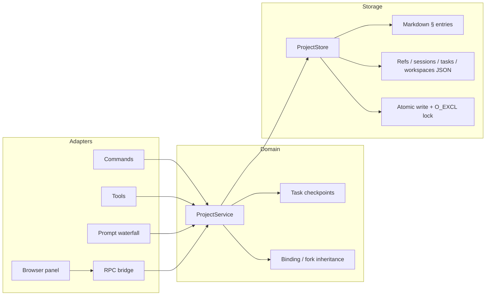

# Architecture

`dsh-projectflow` is a project-first context layer. It is deliberately split into
a **pure storage/domain core** and thin **DSH adapters**, so the majority of the
plugin can be tested without booting DSH.

## 1. Goals and non-goals

**Goals**

- A project is a durable entity with a stable id, independent of any directory.
- Any session can join a project; a fork inherits the parent binding.
- Project context is injected once per prompt assembly under a hard budget.
- Writes are explicit, atomic, concurrent-safe, and human-readable on disk.
- The same domain is available from tools (model), commands (TUI), and a
  browser/Desktop panel.
- Project data survives plugin removal.

**Non-goals**

- Replacing DSH Workspaces or the sandbox. A DSH Workspace is still a directory.
- Running workflows. DSH's `workflow` tool remains the orchestration engine.
- Automatic conversation summarization or hidden memory extraction.
- Copying referenced files, tool code, plugin bundles, or MCP prototypes.
- Calling an external service or making network requests.

## 2. Layers

### `src/store/`

- `project-store.ts` — project lifecycle, snapshots, note/ref/progress/task
  writes, fork/merge/delete, archive triggers.
- `markdown.ts` — the `§` entry protocol, ADR body parse/render.
- `progress.ts` — JSONL validation, idempotency window, archive pointer.
- `refs.ts`, `sessions.ts`, `tasks.ts`, `workspaces.ts` — typed file models.
- `archive.ts` — archive files and `archive/index.json`.

Storage never imports DSH. It can be exercised with a temporary `projectsDir`.

### `src/domain/project-service.ts`

The transaction boundary and read model. It:

- resolves project names/aliases/ids;
- enforces the bound-session rule;
- materializes fork inheritances;
- builds `ProjectStatus` and the bounded context snapshot;
- coordinates task records;
- implements workspace composition (insert/fork/merge/delete).

### `src/injection/`

- `token-estimate.ts` — conservative ASCII/CJK estimate.
- `render.ts` — priority-ordered blocks and hard budget enforcement.

The renderer is pure. It never writes files and never calls a model.

### `src/dsh/`

- `contracts.ts` — minimal structural host contracts, verified against
  `0.2.1-rc.2`; no runtime host imports.
- `tools.ts` — eight zod-validated tool adapters.
- `commands.ts` — `/project` parsing and human-facing output.
- `prompt.ts` — `system-prompt/assemble` contribution, fork inheritance,
  turn-boundary task checkpoints.
- `rpc.ts` — authenticated browser prefix Web route (`connection.admit`).

### `src/client/`

- `index.tsx` — footer action and project workspace page.
- `api.ts` — RPC call facade.

The client bundle is a DSH packaged-client factory
(`window.__ModuleLoader__.load({ id, factory })`), built by esbuild and
externalizing React and DSH client packages.

## 3. DSH integration points

### System prompt

`system-prompt/assemble` is an asynchronous waterfall. The plugin calls
`next()` first, then appends one `AssembledSection` named `projectflow:context`
with `interpolate: false`.

Why append after `next()`:

- it can perform asynchronous project reads without a synchronous prompt
  provider;
- it preserves every other contributor, including dsh-mnemon;
- replacing only our own section makes re-assembly idempotent.

The section text is stable while the project is unchanged, which limits
`systemPromptUpdate: in-history` churn for models such as deepseek-flash.

### Session lineage

`SessionHeader.parentSession` is durable fork metadata. On `agent/created`, the
plugin looks up the parent's binding across project `sessions.json` files and
archives, then writes the child binding **before** the first prompt is
assembled. A parent rebound later does not change an already-materialized child.

Fallback: if lineage or the parent binding is unavailable, the child stays
unbound and `project_status` says so. The plugin never guesses from `cwd`.

### Task checkpoints

`session/event` is used only at `turn/start` and `turn/end`. Each checkpoint is
a read of the session log plus one small `tasks.json` write. The plugin does not
write on assistant chunks or every tool event.

`project_task interrupt`:

1. reads the session log into a checkpoint;
2. writes the task record with `status: interrupted` and `pendingPrompt`;
3. calls `agent.cancel({ kind: 'hook', reason })`;
4. the next assembly renders the prompt at the top of the project section.

Cancellation is cooperative by design. A plugin must not hard-kill a tool
process owned by DSH.

### Commands and tools

Both adapters call the same `ProjectService` methods. Tool arguments are
validated by Zod; command arguments use a quoting-aware tokenizer. Errors are
`ProjectError` values with a code, message, and optional next action.

### Browser bridge

A prefix Web route at `/projectflow` is registered only when `connection` and
`webServer` services exist. It applies `connection.admit(req)` before reading
the envelope. Each response is `{ ok, value }` or
`{ ok: false, error: { code, message } }`. The browser client never accesses the
filesystem directly. The route is registered through `webServer.register`
rather than `connection.rpc.handle`; the latter owns the route through the
calling fiber and can block a profile-bundle plugin during boot.

## 4. Storage transactions

### Atomic writes

All writes: same-directory temp inode with `wx`, write + fsync, close, rename.
Readers see old or new complete content. Project creation builds the whole tree
in `projects/.tmp-*` and renames the directory into place.

### Locking

- Per-project `.lock` for every mutation.
- `projects/.registry.lock` for global name/alias uniqueness and creation.
- `wx` acquisition with a JSON holder record (`pid`, `hostname`, `startedAt`,
  `nonce`).
- Stale takeover only for a dead same-host PID or an aged lock; the nonce is
  re-read before unlinking.
- Reads are lock-free.

Two-project operations (merge) acquire locks in sorted id order to avoid
deadlock. Rebinding writes the new binding first, then removes the old
best-effort; the resolver uses the latest `boundAt` if a crash leaves both.

### Capacity

Each record family has a byte/entry limit. Overflow archives old entries and
leaves either a per-entry pointer (Markdown) or a pointer row (progress). JSON
ref arrays remain pure arrays; their archives are catalogued in
`archive/index.json`.

## 5. Context budget

The default is **1200 estimated tokens**, configurable 200–4000.

Priority:

1. project header;
2. current task / pending system injection;
3. conventions;
4. recent decisions;
5. latest five progress entries;
6. reference counts and workspace member count.

Blocks are added in order. If a block does not fit, lines are added until the
budget is exhausted, then a `(+N more)` line is attempted. A final code-point
trim guarantees `estimateTokens(text) <= budget`.

The estimate charges ASCII at 0.25 token/char, CJK/full-width/emoji at 1
token/char, other non-ASCII at 0.5, then applies a 1.1 safety factor. Real
tokenizers may use fewer tokens; the hard budget is on the conservative side.

## 6. Fork and merge semantics

**Fork** copies:

- memory, conventions, decisions;
- refs;
- progress (history);
- workspace members;
- primary path and a new `forkedFrom`.

It does **not** copy bindings or tasks. The forking session is bound to the new
project by the adapter.

**Merge**:

- content-dedupes memory/conventions/decisions;
- dedupes progress by timestamp/session/stage/text;
- unions refs;
- removes source-project membership edges when the source is deleted;
- optionally adds the source primary path as a directory member;
- moves source bindings/tasks only when `deleteSource` is true;
- moves the source directory to `.trash` unless `purgeSource` is true.

## 7. Failure handling

| Failure | Behavior |
|---|---|
| Corrupt JSON | `CORRUPT_DATA`; nothing is overwritten |
| Missing project | `PROJECT_NOT_FOUND` with list/use hint |
| Ambiguous alias | `PROJECT_AMBIGUOUS` with project ids |
| Lock contention | `LOCK_TIMEOUT` after the configured wait |
| Archived project | Refuse binding/writes; status remains readable |
| Prompt read failure | Return base assembly; log project id + message |
| Fork inheritance failure | Keep child unbound; log; never fail agent creation |
| Browser RPC failure | Structured error; panel shows message |

## 8. Testing strategy

- Pure storage/domain tests use temporary directories.
- Cross-process tests spawn real writer processes against the built package.
- Prompt tests call the waterfall with a fake agent and assembly.
- Tool/command/RPC tests use structural fakes, so no DSH process is required.
- Client tests register the slots with a fake client context and render the
  panel with React server rendering.
- Live checks use a disposable `dev` profile; the Desktop profile is untouched.

## 9. Version contract

The declared runtime range is `>=0.2.1-rc.2 <0.3.0-0`. Runtime host imports are
avoided; structural contracts are isolated in `src/dsh/contracts.ts`. When the
host API changes, that file and the adapters are the only expected changes.
